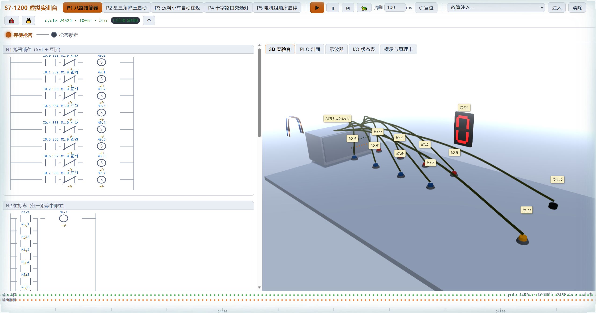
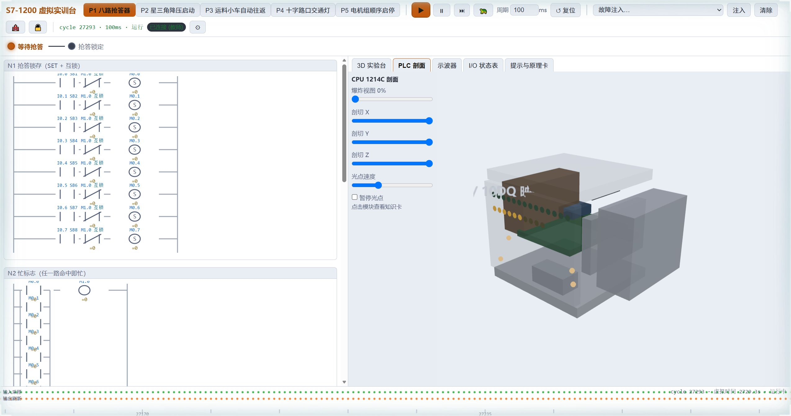

# S7-1200 虚拟 3D 实训平台（前后端分离版）

PLC 内核（IEC 61131-3 扫描循环、I/Q/M/DB 存储区、TON/CTU/SR/P/SEG/CMP/MOVE 原语、
FB 背景数据块）运行在 **Python 后端**；前端为单文件 HTML + Three.js r160，
所有视图只通过 WebSocket 订阅内核状态渲染，不自行推进任何 PLC 逻辑。

## 特性

- **五个教学项目**：八路抢答器 / 星三角降压启动 / 运料小车自动往返 / 十字路口交通灯 / 电机组顺序启停，纯 CONFIG 声明式定义，内核零硬编码
- **3D 实验台**：Three.js 实时场景（PLC、按钮、接触器、电机、交通灯），导线能流亮纹、粒子、LED 与内核状态逐周期同步
- **PLC 剖面视图**：CPU 1214C 结构爆炸图 + 三向剖切 + 光点巡迹，点击模块看知识卡
- **梯形图视图**：能流高亮、在线修改 FB 参数、元件级断点（得电上升沿暂停）
- **示波器 / 时间轴 / I/O 状态表**：全部由历史 scan 消息重建，前端零本地预测
- **教学功能**：故障注入、程序锁、单步/慢速 ×0.1、课堂模式（教师端控权、学生端只读 + 操作广播）
- **深色 / 浅色双主题**：3D 场景灯光、材质、示波器全联动；支持 `?theme=` URL 覆盖

## 截图

| 3D 实验台（浅色主题） | PLC 剖面（浅色主题） |
|---|---|
|  |  |

## 启动命令

```bash
# 最省事：双击 launch.bat（自动选 Python 环境、自检依赖、起服务、开浏览器）

# 或手动：
pip install -r backend/requirements.txt
uvicorn backend.main:app --host 0.0.0.0 --port 8000
# 浏览器打开 http://localhost:8000/  （FastAPI 静态托管前端，无需第二条命令）
# 也可以 python -m backend.main（脚本直启会自动打开浏览器）
```

- 课堂多机：学生端打开 `http://<教师机IP>:8000/?role=student`；第一个连接自动成为教师端。
- 自测：`python -m backend.selftest`（五项目内核行为断言，不依赖网络）。
- 界面主题：Esc 设置 → 显示 → 深色/浅色（存 localStorage，3D 场景与示波器联动）；也可用 URL 参数 `?theme=light` / `?theme=dark` 临时覆盖（不写入存档）。

## 目录结构

```
PLC_1/
├── launch.bat              # Windows 一键启动（GBK 编码，自动选环境/装依赖/开浏览器）
├── docs/                   # README 截图
├── backend/
│   ├── main.py               # FastAPI 入口：/ws/plc、/api/*、静态托管 frontend/
│   ├── requirements.txt
│   ├── app_state.py          # 当前项目、课堂模式、程序锁、客户端角色
│   ├── selftest.py           # 内核行为自测（五项目断言）
│   ├── ws_smoke.py           # WebSocket 冒烟测试
│   ├── core/                 # ★ PLC 内核：纯 Python，零 FastAPI 依赖
│   │   ├── memory.py         #   I/Q/M 存储区（位/字节/字寻址）
│   │   ├── datablock.py      #   DB 背景数据块（按 FB 实例自动生成）
│   │   ├── primitives.py     #   TON/CTU 状态更新、SEG 译码表
│   │   ├── networks.py       #   声明式梯形图网络 + 能流求值器（触点/线圈/SR/P/CMP/MOVE/CALL）
│   │   ├── blocks.py         #   FB 定义与 OB1 结构强制校验（项目4 单次调用）
│   │   ├── events.py         #   周期事件总线（慢消费者 latest-wins）
│   │   └── scan.py           #   扫描循环引擎：周期/单步/慢速、虚拟时钟、广播
│   ├── projects/             # 五份纯 CONFIG，零内核复制，懒加载
│   │   ├── base.py           #   ProjectConfig pydantic 模型
│   │   ├── registry.py       #   项目注册与切换
│   │   ├── p1_quiz_buzzer.py / p2_star_delta.py / p3_shuttle_car.py
│   │   └── p4_traffic_light.py / p5_motor_seq.py
│   └── api/
│       ├── schemas.py        # ★ 消息协议 pydantic 模型（单一事实源）
│       ├── ws.py             #   /ws/plc 端点、角色仲裁、上行路由
│       └── rest.py           #   /api/projects、/api/snapshot、/api/health
└── frontend/
    └── index.html            # 单文件：WS 客户端 + 梯形图/3D/剖面/示波器/时间轴
```

## 消息协议（与 `backend/api/schemas.py` 逐字段一致）

端点 `/ws/plc`，JSON 文本帧，`type` 判别。`cycle` 严格递增，是所有视图的对齐锚点；
`vts_ms` 为虚拟时钟（慢速 ×0.1），TON/时间轴/示波器横轴一律使用它。

### 上行（客户端 → 服务端）

| type | 载荷 | 说明 |
|---|---|---|
| `hello` | `{client_name, role:"teacher"\|"student"}` | 握手，服务端回 `hello_ack` 全量快照 |
| `input` | `{addr:"I0.0", value:0\|1}` | 外部信号，进待采样缓冲，下一采样点锁存 |
| `set_period` | `{ms:50..2000}` | 扫描周期 |
| `set_mode` | `{mode:"run"\|"pause"\|"slow"}` | slow = 虚拟时钟 ×0.1 |
| `step` | `{}` | 暂停模式下单步推进 1 周期 |
| `inject_fault` | `{id:"FR_TRIP", on:true}` | 故障注入（清单随项目 CONFIG 下发） |
| `program_lock` | `{locked:true}` | 程序锁 |
| `class_mode` | `{on:true}` | 课堂模式：开启后控制类消息仅受理 teacher |
| `switch_project` | `{id:"p2_star_delta"}` | 切换项目：内核重建，全客户端广播新 CONFIG |
| `reset` | `{}` | 清 I/Q/M/DB 重新上电（cycle 不回退，epoch+1） |
| `set_param` | `{db:"DB_SD", field:"pt_star", value:5000}` | 在线改背景 DB 参数（延时可调） |
| `set_breakpoint` | `{uid:"OB1:N1.R1.s0", once:true}` | 能流得电上升沿命中 → 全局暂停 |
| `clear_breakpoint` | `{uid?:...}` | 省略 uid = 清除全部 |
| `ping` / `pong` | `{t}` | 延迟测量 |

### 下行（服务端 → 客户端）

| type | 时机 | 要点 |
|---|---|---|
| `hello_ack` | 握手一次 | `config`（项目全量 CONFIG）+ `snapshot` + `settings` + `you.role` + `projects` |
| `project_config` | 切换项目广播 | 新 CONFIG + settings |
| `scan` | 每周期 | 见下 |
| `settings` | 设置变更广播 | period/mode/class_mode/program_lock/faults_on |
| `event` | 按需 | `breakpoint_hit` / `fault_on` / `fault_off` / `stage_change` / `reset` |
| `ack` / `error` | 按需 | 错误带 `ref`（上行 type）与 `msg` |

`scan` 消息字段：`epoch, cycle, ts_ms, vts_ms, period_ms, mode, stage, stage_index,
stage_remain_ms, I{addr:0/1}, Q{...}, M{...}, DB{实例:快照}, timers{路径:{ET,PT,Q}},
counters{路径:{CV,PV,Q}}, flow{元件uid:0/1}, events:["sample","refresh"]`。

元件 uid 规则：`<作用域>:<网络>.<梯级>.<位置>`，作用域为 `OB1` 或 FB 实例名
（如 `DB_SD`）；位置为 `b{分支}e{序号}` / `s{序号}` / `o{序号}`。

### 关键机制

- **滞后一拍（教学点）**：上行 `input` 只进待采样缓冲，下一周期①采样阶段才锁存进 I 区；
  示波器 I 波形完全由历史 scan 重建，前端零本地预测。
- **课堂模式**：`class_mode` 开启后控制类上行仅受理 teacher；断线即冻结，重连走 `hello` 快照追平。
- **慢消费者**：每客户端独立队列，满了丢旧 `scan`（latest-wins）；客户端发现 cycle 跳号
  可拉 `/api/snapshot` 追平。事件/配置类消息不丢。

## 迁移核对清单（原 JS 内核功能 → Python 模块）

| 原 JS 内核功能 | Python 侧落点 |
|---|---|
| I/Q/M 存储区、位/字节/字寻址 | `core/memory.py` `Memory` |
| DB 背景数据块、按 FB 实例自动生成 | `core/datablock.py` `DataBlock` + `core/scan.py` `load_project` |
| 扫描循环（采样→OB1→写Q→广播）、周期 50ms-2s、单步、慢速×0.1 | `core/scan.py` `ScanEngine`（慢速=虚拟时钟×0.1） |
| 常开/常闭/线圈/SET/RST/SR/RS/上升沿P/CMP/MOVE/SEG | `core/networks.py` 求值器 + `core/primitives.py` |
| TON（FB 形式、ET 输出）、CTU | `core/primitives.py`（状态存实例背景 DB） |
| FB（IN/OUT/STAT）与 OB1 调用关系、实例展开 | `core/blocks.py` + `networks.py` `_call_fb`（uid 按实例隔离） |
| 每周期广播 {cycle,I,Q,M,DB,flow,stage,timers} | `core/scan.py` `_build_scan_msg` → `core/events.py` |
| 项目 CONFIG 声明、内核零硬编码、五项目共用 | `backend/projects/*`（纯声明，懒加载） |
| 故障注入（强制/程序变体）、断点、程序锁、课堂模式 | `core/scan.py` + `api/ws.py` + `app_state.py` |
| 消息协议 | `api/schemas.py`（pydantic 单一事实源） |

## 已知局限

1. **网络延迟 > 扫描周期**：时间轴/示波器按 `cycle` 对齐而非消息到达时刻；慢消费者被丢帧时
   cycle 跳号可见，波形出现缺口（不伪造数据）。局域网/单机教学场景下无感。
2. TON 的 ET 分辨率 = 扫描周期（真实 PLC 同样如此）。
3. 交通灯相位实测时长 = 设定值 + 最多 2 个扫描周期（自复位定时器特性），原理卡“实测”联动可见。
4. 慢速模式 = 虚拟时钟 ×0.1（扫描节奏不变），示波器/TON 同步拉伸。
5. 剖面视图为结构示意模型，非真实器件 1:1；能流是**逻辑状态**可视化，非真实电流。
6. 前端 Three.js r160 需一次性访问 CDN（jsdelivr）；断网环境需自行换本地镜像。
7. 设置中“运动模糊”项未实现（保留占位）；LOD 档位目前只影响装饰网格显隐策略。
8. 多客户端并发 `input` 按到达序进下一采样周期，不做锁仲裁。
9. 复位/切项目后 `cycle` 不回退（epoch 递增），客户端以 `(epoch, cycle)` 判新纪元并清空历史。
